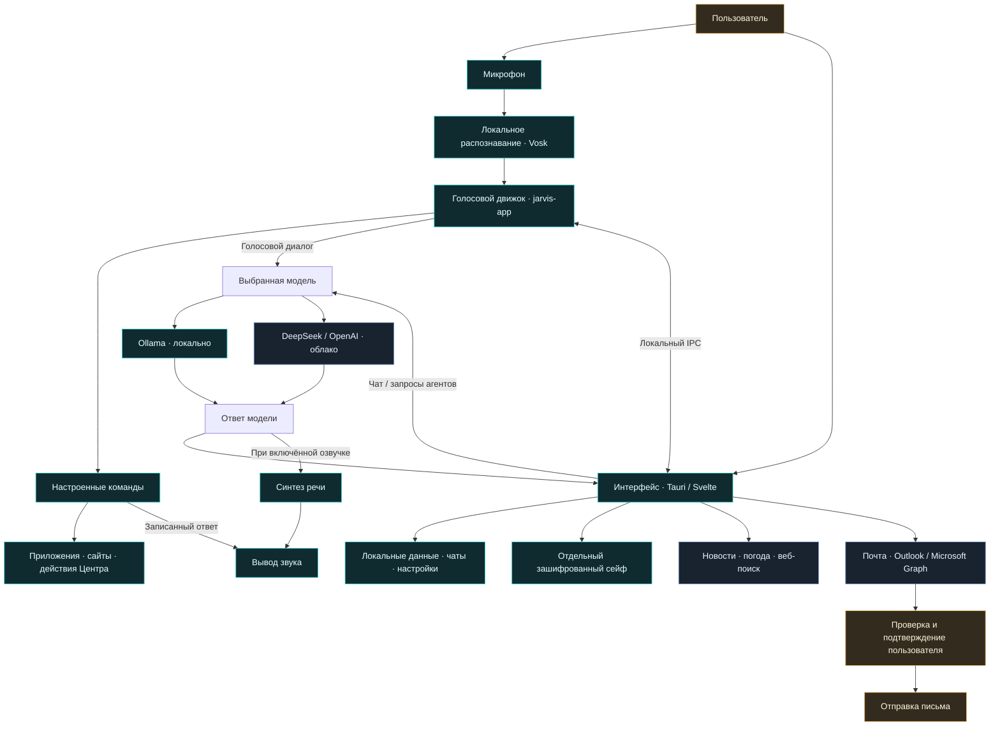
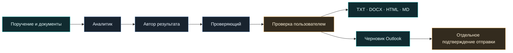

<div align="center">


# JARVIS · ALTRON

### Голос. Диалог. Личный центр.

Настольный помощник для повседневных дел и офисных задач.<br>
Локальные инструменты, подключаемые модели и контроль пользователя.

[](https://github.com/DIBERLOG/JARVIS_ALTRON_CLEAN/releases/tag/v1.0.0)
[](#platforms)
[](Cargo.toml)
[](crates/jarvis-gui/tauri.conf.json)
[](frontend/package.json)

**[Скачать Windows-релиз](https://github.com/DIBERLOG/JARVIS_ALTRON_CLEAN/releases/tag/v1.0.0) · [Установка](docs/INSTALL.md) · [Документация](#documentation) · [Лицензия](LICENSE.txt)**

[](mailto:workspace34t@gmail.com)

</div>

---

> [!WARNING]
> **Release 1.0.0:** экспериментальные разделы «Агенты · LAB», Microsoft 365 и перенос на другие ОС могут работать некорректно. Сообщайте об ошибках на [workspace34t@gmail.com](mailto:workspace34t@gmail.com). Не прикладывайте ключи и личные данные.

В [релизе v1.0.0](https://github.com/DIBERLOG/JARVIS_ALTRON_CLEAN/releases/tag/v1.0.0) предназначен Windows x64 установщик; Linux/macOS и Android пока доступны только как экспериментальные исходники. Старый пререлиз v0.9.0 остаётся без установщика и не содержит последующих доработок автоматически.

<details>
<summary><strong>🧭 Навигация по README</strong></summary>

## Содержание

- [Возможности](#возможности)
- [Как устроен JARVIS](#как-устроен-jarvis)
- [Первый запуск](#первый-запуск)
- [Установка по шагам](docs/INSTALL.md)
- [История версий](#история-развития--010--090)
- [Почта Outlook и Kerio](#почта-outlook-и-kerio)
- [Агенты · LAB](#агенты--lab)
- [Данные и безопасность](#данные-и-безопасность)
- [Сборка из исходников](#сборка-из-исходников)
- [Диагностика](#диагностика)
- [Документация и разработка](#документация-и-разработка)
- [Платформы и ограничения](#платформы-и-ограничения)
- [Авторство и лицензия](#авторство-и-лицензия)

</details>

---

## Возможности

| Раздел | Что доступно |
| --- | --- |
| Голосовые команды | Запуск приложений и сайтов, погода, напоминания, почта и другие настроенные действия. Актуальные фразы — во вкладке «Команды» |
| Чат | Локальная Ollama / Qwen, DeepSeek или OpenAI; личности JARVIS и ALTRON; поиск бесед и экспорт текущего или всех чатов в JSON |
| Центр | Новости, календарь, напоминания, дни рождения, заметки, диктовка, таймер, погода, привычки, тренировки, пароли и история запросов |
| Почта | Классический Outlook / Kerio на Windows; отдельный экспериментальный режим Microsoft 365 / Outlook.com |
| Агенты · LAB | Подготовка писем, документов и задач; цепочки из трёх помощников; исходные документы и экспорт результатов |
| Настройки | Раздельные настройки слушания, микрофона, распознавания, моделей, озвучки, сайтов и резервных копий |

### ✨ Что особенно интересно

**🎙️ От команды к разговору — без смены приложения.** Откройте программу голосом, перейдите в диалог и задайте вопрос выбранной модели. Обычные команды остаются доступными внутри разговора. Для заметки используйте отдельную диктовку: она записывает слова, не выполняя произнесённые действия.

**🧠 Своя модель, свой стиль.** Ollama позволяет отвечать локально; DeepSeek и OpenAI подключаются собственными API-ключами. JARVIS и ALTRON предлагают разные манеры общения. История текстовых бесед доступна слева: можно вернуться к чату, найти его и экспортировать сообщения.

**✉️ Письмо голосом в настоящем Outlook.** Продиктуйте адрес, тему и текст или исправьте их вручную в открытом черновике. Недавние адресаты помогают выбрать получателя, но адрес нужно подтвердить. Перед отправкой остаётся отдельная проверка — модель не получает разрешение рассылать письма самостоятельно.

**🤝 Офисная команда из трёх помощников.** В «Агенты · LAB» можно разобрать исходный документ, подготовить письмо и проверить итог; собрать план встречи, сравнить предложения поставщиков или подготовить недельный отчёт. Ход работы виден по этапам. Результат редактируется, таблицы отображаются в предпросмотре, экспорт доступен в Word, HTML, Markdown и TXT.

**📎 Документы как исходные данные.** Прикрепите DOCX или поддерживаемые текстовые файлы, проверьте извлечённый текст и только затем отправьте поручение выбранной модели. Файлы не изменяются; лишний контекст можно удалить. Облачные запросы требуют осознанного выбора данных и могут оплачиваться.

**🗓️ Личный центр вместо россыпи маленьких приложений.** Календарь, редактируемые голосовые напоминания, будущие дни рождения, форматированные заметки и таймер собраны рядом. Привычки и тренировки показывают статистику по вашим сохранённым отметкам, а не демонстрационные цифры.

**🌍 Новости и погода с реальными источниками.** В новостях доступны темы, регионы, переход к оригиналу и локальный перевод карточек. Погода показывает прогноз на семь дней. Веб-поиск дополняет модель найденными материалами, но не заменяет проверку важных фактов.

**🔐 Отдельный сейф и перенос данных.** Секретные карточки защищены отдельным зашифрованным хранилищем; личные данные Центра и чаты можно экспортировать. Это ручные резервные копии, не облачная синхронизация и не гарантия защиты всего компьютера.

JARVIS и ALTRON отличаются манерой ответа, а не правами или достоверностью. Модель может ошибаться; найденные в интернете сведения проверяйте по источникам.

Текстовые беседы сохраняются локально. Для ответа используется до 20 последних сообщений выбранной беседы; голосовой диалог ведёт отдельный контекст. История запросов Центра — статистика обращений, а не полный архив ответов.

Свой сайт расписания задаётся в «Настройки → Сайты и команды» или из списка команд. «Джарвис, открой расписание» открывает сохранённую HTTP/HTTPS-ссылку; если её нет — предлагает ввести. Это не меняет календарь Центра.

### Локальные и сетевые функции

Заметки, календарь, привычки, тренировки и сейф работают локально. Распознавание и диктовка требуют установленной модели Vosk; локальный чат — работающей Ollama и загруженной модели. Перевод новостей и автопунктуация используют локальную `qwen3:4b-instruct`.

Новости, прогноз погоды, веб-поиск, DeepSeek и OpenAI требуют интернета. Облачной модели передаются запрос и выбранный контекст; возможны расходы провайдера. API-ключи не прилагаются. Веса моделей и личные данные в репозиторий не входят.

## Как устроен JARVIS



Схема упрощённая: голосовые команды и чат используют разные пути обработки, а сейф не передаётся модели автоматически. Интернет нужен внешним сервисам; локальная модель требует заранее загруженных весов. Агенты готовят результат, но не получают самостоятельного доступа к запуску программ и отправке писем.

<a id="quick-start"></a>

## Первый запуск

**Начните здесь: [пошаговая установка для всех платформ](docs/INSTALL.md).** На Windows используйте установщик из Releases; для сборки разработчика доступны скрипты. Linux/macOS и Android — экспериментальные исходники.

У приложения два процесса:

| Процесс | Назначение |
| --- | --- |
| `jarvis-app.exe` | Микрофон, распознавание, выполнение команд и голосовой разговор |
| `jarvis-gui.exe` | Интерфейс, настройки, чат и Центр |

Для голоса запускайте оба процесса одной сборки с совместимыми ресурсами. Они связываются через локальный WebSocket `127.0.0.1:9712`. Без движка локальные разделы интерфейса могут оставаться доступными.

1. Выберите физический микрофон и подходящую по языку Vosk-модель, сохраните настройки. После смены устройства может потребоваться перезапуск движка.
2. Проверьте: «Джарвис, открой калькулятор».
3. В «Настройки → Модели и ответы» выберите источник, модель и при необходимости свой API-ключ. Проверьте короткий вопрос в чате.
4. Проверьте записанный ответ команды и синтез речи отдельно. Для первого теста используйте физические наушники без виртуальных кабелей.
5. Попробуйте «Голос в текст» и убедитесь, что текст распознаётся, а заметки сохраняются после перезапуска.

«Джарвис, давай пообщаемся» включает разговорный режим. Для выхода: «хватит общаться», «закрой диалог» или «режим команд». Обычные команды доступны и внутри разговора.

Кнопка слушания и горячая клавиша (по умолчанию **Ctrl+Alt+J**) управляют приёмом команд. Пауза микрофона не останавливает уже начатую озвучку — для неё есть отдельная кнопка.

Диктовка превращает речь в текст, а не выполняет произнесённые команды. Её микрофон и микрофон глобального слушателя могут настраиваться отдельно.

Озвучка зависит от выбранного движка и подготовленных ресурсов. Voicemod / VB-CABLE необязательны; подключайте их после проверки прямого звука. Инструкции: [голосовой runtime](docs/VOICE_RUNTIME.md), [S2 Pro](docs/S2_LOCAL_VOICE.md), [ресурсы TTS](resources/tts/README.md).

## Почта Outlook и Kerio

### Классический Outlook — Windows

Нужен **классический Outlook**, настроенный профиль с одной учётной записью; для Kerio — Kerio Outlook Connector и доступный сервер. Новый Outlook не поддерживает этот режим. Пароль остаётся в Outlook, Microsoft Client ID не нужен.

В «Центр → Почта Outlook» подключите открытый Outlook. Привязка к профилю сохраняется; при необходимости JARVIS запускает классический Outlook. Если профиль или адрес изменились, подключите его заново.

Настройки профиля: «Панель управления → Почта → Показать профили». Запасной вход: **Win+R → `control mlcfg32.cpl`**.

Пример письма:

1. «Джарвис, напиши письмо» — открывается черновик Outlook.
2. Продиктуйте адрес или введите его в «Кому», нажмите Tab и скажите «Адрес указал».
3. Продиктуйте тему и текст. Подсказки из недавних получателей подтверждаются отдельно.
4. По желанию выберите «Оформи текст» или «Без форматирования».
5. «Джарвис, отправь письмо» → проверка адреса и текста → «Да, отправить».

Изменение письма отменяет прежнее подтверждение. При ошибке или неизвестном результате сначала проверьте «Отправленные» и «Исходящие»: повтор может создать дубликат. Принятие Outlook не гарантирует доставку.

Режим «В окне Outlook» сохраняет нативные окна, но JARVIS должен оставаться запущенным для распознавания голоса. Адреса `@jarvis.test` относятся только к локальной лаборатории, не к интернет-почте.

[Настройка профиля, адресатов и голосового письма](docs/OUTLOOK_LOCAL.md).

### Microsoft 365 / Outlook.com

> [!IMPORTANT]
> Режим реализован через Microsoft Graph, но полноценно не протестирован на реальных аккаунтах: вход, чтение и отправка могут работать некорректно.

Нужен собственный публичный Application (client) ID; пароль и client secret JARVIS не запрашивает. Вход действует до закрытия GUI, токены остаются в памяти. Рабочий аккаунт может потребовать согласие администратора. Письма не передаются модели автоматически.

[Инструкция подключения и ограничения](docs/OUTLOOK_SETUP.md).

## Агенты · LAB

Экспериментальные офисные помощники готовят **редактируемый результат**, а не выполняют работу автономно:

- «Почта» — тема, текст или ответ на предоставленное письмо.
- «Документы» — отчёт, служебная записка, резюме.
- «Задачи» — план, приоритеты, исполнители и сроки из исходных данных.
- «Саб-агенты» — шесть сценариев с тремя последовательными этапами, просмотром промежуточных результатов и остановкой.

К контексту можно прикрепить **DOCX, TXT, MD, CSV, JSON и LOG**: до пяти файлов по 5 МБ, общий контекст до 12 000 символов. Текст извлекается локально; сокращение требует подтверждения. PDF, сканы, DOC и XLSX пока не поддерживаются. Это данные для модели, не вложения в письмо.

Есть форматированный просмотр, включая таблицы. Итоги экспортируются в **TXT, DOCX, HTML и Markdown**; промежуточные этапы — в TXT. Результаты не сохраняются автоматически: экспортируйте до ухода со страницы.

Агенты не читают почту и файлы самостоятельно, не запускают программы, не создают напоминания и не отправляют письма. После ручной проверки письмо можно перенести в черновик классического Outlook. Отправка остаётся отдельным подтверждаемым действием.

Облачные этапы могут оплачиваться. Остановка не отменяет уже отправленный запрос, но предотвращает следующие этапы. Проверка другим помощником не гарантирует отсутствие ошибок.

[Сценарии, первый тест и ограничения](docs/AGENTS_LAB.md).

### Как проходит работа команды



*Схема относится к почтовой цепочке: экспорт и перенос черновика выбирает пользователь. Автоматической отправки нет.*

## Данные и безопасность

В настройках доступны ручной экспорт и импорт данных Центра: заметки, календарь, напоминания, дни рождения, привычки, город и тренировки. **Импорт заменяет переносимый набор, а не объединяет его** — сначала сделайте резервную копию.

Чаты экспортируются отдельно в JSON. API-ключи, модели и общие настройки не входят в экспорт данных Центра. Это не облачная синхронизация.

Сейф паролей хранится отдельно в зашифрованном `password-vault-v1.json` в каталоге данных приложения `com.priler.jarvis` (на Windows проверьте `%APPDATA%`). Он использует AES-GCM с 256-битным ключом; получение ключа из мастер-пароля — PBKDF2 / SHA-256, 600 000 итераций.

- Сохраните ключ восстановления **вне JARVIS**: он даёт полный доступ.
- Для восстановления нужны зашифрованный файл и мастер-пароль **или** ключ. Ключ не заменяет резервную копию.
- Экспорт сейфа требует того же мастер-пароля, который его открывает; секреты восстановления в экспорт не входят.
- Обычные заметки, настройки, API-ключи и экспорт чатов не защищаются шифрованием сейфа автоматически.
- При блокировке или уходе из сейфа несохранённые изменения очищаются.

Сейф не проходил независимый аудит и не защищает от вредоносного ПО или доступа к памяти разблокированного приложения. Не делайте экспериментальную версию единственным местом хранения критичных секретов.

Резервные копии делайте при закрытом приложении. Не публикуйте личные настройки, ключи, сейф или неочищенные логи. [Подробности переноса](docs/REMINDERS_AND_BACKUP.md).

## Сборка из исходников

### Требования

- Windows, Rust с MSVC toolchain, C++ Build Tools и Windows SDK.
- Node.js / npm и WebView2.
- Локальные библиотеки аудио и Vosk из `lib/windows/amd64`.
- Ресурсы команд и подходящая модель распознавания.
- AutoHotkey для сценариев, которые его используют.

Ollama нужна для локальных модельных функций. Python, PyTorch и дополнительные веса нужны выбранному TTS или обучению голоса, а не всем разделам Центра.

<details>
<summary><strong>🔧 Компиляция и подготовка ресурсов — PowerShell</strong></summary>

### Компиляция

В PowerShell:

```powershell
git clone https://github.com/DIBERLOG/JARVIS_ALTRON_CLEAN.git
cd JARVIS_ALTRON_CLEAN
cd frontend
npm ci
npm run build
cd ..
$env:LIB = (Join-Path (Get-Location) 'lib\windows\amd64') + ';' + $env:LIB
cargo build -p jarvis-app
cargo build -p jarvis-gui
```

Для свежей debug-сборки подготовьте ресурсы и DLL. **Если в целевой папке уже есть ваши настройки, сначала сохраните их: копирование заменяет одноимённые файлы.**

```powershell
Copy-Item -LiteralPath '.\resources' -Destination '.\target\debug' -Recurse -Force
Get-ChildItem -LiteralPath '.\lib\windows\amd64' -Filter '*.dll' |
    Copy-Item -Destination '.\target\debug'
```

Копирование не скачивает модели и не подготавливает Python-среду. Один EXE без ресурсов не является переносимой сборкой. Упаковку установщика по `crates/jarvis-gui/tauri.conf.json` нужно проверять отдельно, включая оба процесса, DLL и запуск на другом ПК.

### Локальные модели и запуск

```powershell
ollama pull qwen3:8b
ollama pull qwen3:4b-instruct
Start-Process -FilePath '.\target\debug\jarvis-app.exe' -WorkingDirectory '.\target\debug' -WindowStyle Hidden
Start-Process -FilePath '.\target\debug\jarvis-gui.exe' -WorkingDirectory '.\target\debug' -WindowStyle Hidden
```

Команды запуска выполняются из корня репозитория. Ollama должна быть установлена; попытка её фонового запуска не скачивает отсутствующие модели. Не держите одновременно несколько копий JARVIS.

Для конфигурации с Voicemod есть [скрипт запуска](tools/start-jarvis-voicemod.ps1); он не создаёт автозапуск Windows автоматически.

</details>

### Обновление

Сохраните результаты и резервные копии, закройте оба процесса. Если собственных изменений нет, проверьте remote и выполните `git pull --ff-only`, затем заново соберите frontend и оба Rust-процесса. При локальных изменениях сначала сохраните их и разберите пересечения — не используйте принудительный сброс.

Обновление исходников не заменяет запущенный EXE. После сборки проверьте голос, чат, звук и сохранность данных; не удаляйте пользовательскую базу ради обновления интерфейса.

## Диагностика

| Проблема | Что проверить |
| --- | --- |
| Голосовой модуль не подключён | Запущен ли `jarvis-app.exe` той же сборки, его лог и свободен ли порт 9712 |
| Микрофон молчит или речь распознаётся неверно | Физическое устройство, разрешения Windows, паузу слушания и язык Vosk; отдельно протестируйте диктовку |
| Команда распознана, но приложение не открылось | Установку программы, пути и ресурсы сценария, AutoHotkey и лог выполнения |
| Нет озвучки | Отдельно записанные ответы и TTS; модель, зависимости и устройство вывода |
| Слышен собственный голос | «Hear myself» в Voicemod, «Прослушивать» в Windows и мониторинг гарнитуры |
| Локальная модель, перевод или пунктуация не отвечают | `ollama list`, доступность сервера `127.0.0.1:11434`, выбранную модель и память |
| Новости или погода недоступны | Доступность внешнего сервиса; повторите позже — работа других сайтов не исключает сбоя источника |
| Outlook не выполнил запрос | Классический Outlook, нужный профиль и запрос безопасности; до повтора отправки проверьте папки отправки |
| После сборки старый интерфейс | Сначала сборку frontend, затем GUI, путь запуска и отсутствие старой копии |
| Ошибка линковщика / запуска EXE | MSVC toolchain, `LIB`, DLL, ресурсы и разрядность сборки |
| Не открывается сейф | Сохранность файла, мастер-пароль или ключ восстановления |

Панель логов JARVIS показывает работу движка и принимает его текстовые команды. Это не PowerShell и не системная консоль; скрытие панели не останавливает движок.

В сообщении об ошибке укажите версию, раздел, шаги воспроизведения и обезличенный фрагмент лога. Не прикладывайте API-ключи, ключ восстановления и личное содержимое документов.

<a id="documentation"></a>

## Документация и разработка

| Тема | Руководство |
| --- | --- |
| Чат, OpenAI и история бесед | [CHAT_AND_OPENAI](docs/CHAT_AND_OPENAI.md) |
| Классический Outlook / Kerio | [OUTLOOK_LOCAL](docs/OUTLOOK_LOCAL.md) |
| Microsoft 365 / Outlook.com | [OUTLOOK_SETUP](docs/OUTLOOK_SETUP.md) |
| Агенты, документы и экспорт | [AGENTS_LAB](docs/AGENTS_LAB.md) |
| Напоминания и резервные копии | [REMINDERS_AND_BACKUP](docs/REMINDERS_AND_BACKUP.md) |
| Голосовые команды Центра | [CENTER_VOICE_COMMANDS](docs/CENTER_VOICE_COMMANDS.md) |
| Голосовой runtime и S2 Pro | [VOICE_RUNTIME](docs/VOICE_RUNTIME.md), [S2_LOCAL_VOICE](docs/S2_LOCAL_VOICE.md) |
| Миграция ядра | [CORE_MIGRATION](docs/CORE_MIGRATION.md) |
| Экспериментальное обучение голоса | [voice_training](tools/voice_training/README.md) |

<details>
<summary><strong>🧩 Устройство проекта и проверки для разработчика</strong></summary>

### Структура

- `crates/jarvis-core` — настройки, модели, команды, распознавание, звук и IPC.
- `crates/jarvis-app` — голосовой движок и обработка диалога.
- `crates/jarvis-gui` — окно Tauri и desktop-команды.
- `frontend/src` — страницы Svelte, компоненты и логика интерфейса.
- `frontend/tests` — проверки поведения интерфейса.
- `resources` — определения команд, записанные ответы и ресурсы моделей.
- `tools` — вспомогательные скрипты.

Добавление новой фразы или MP3 само по себе не реализует действие: нужны маршрутизация, разбор параметров, выполнение, сохранение результата и проверки. Промпт модели не заменяет эти механизмы.

### Проверки

Frontend проверяется командой `npm run build` из `frontend`. Для Rust из корня репозитория:

```powershell
$env:LIB = (Join-Path (Get-Location) 'lib\windows\amd64') + ';' + $env:LIB
cargo test -p jarvis-core
cargo test -p jarvis-gui
```

Для сценариев в `frontend/tests` смотрите инструкции запуска конкретного файла: некоторым нужна отдельная DOM-среда; единой команды `npm test` нет. Тесты с сетью, моделью или устройствами могут требовать ручного запуска. Успешная компиляция не подтверждает работу внешнего сервиса или готового установщика.

</details>

<a id="platforms"></a>

## Версии для вашей системы

**Один JARVIS — отдельный пакет для каждой платформы.** Номер исходников общий, но готовность и установщики различаются. Windows-релиз не означает, что сборки Linux и macOS уже проверены.

| Система | Версия / статус | Архитектура | Пакет |
| --- | --- | --- | --- |
| 🖥️ Windows | **1.0.0 · Release** | x64 | Установщик `.exe` — опубликован |
| 🐧 Linux | **1.0.0 · Experimental** | x64 | `.deb` / AppImage — нативная сборка и проверка |
| 🍎 macOS · Intel | **1.0.0 · Experimental** | x86_64 | `.app` / `.dmg` — нативная сборка и проверка |
| 🍎 macOS · Apple Silicon | **1.0.0 · Experimental** | arm64 · M-серия | Отдельные `.app` / `.dmg` — нативная сборка и проверка |
| 📱 Android | **1.0.0 · Mobile LAB** | Отдельный мобильный проект | Исходники; проверенного APK пока нет |

### 🖥️ Windows — готовый релиз

[](https://github.com/DIBERLOG/JARVIS_ALTRON/releases/tag/v1.0.0)

Скачайте установщик x64 из [Releases](https://github.com/DIBERLOG/JARVIS_ALTRON/releases/tag/v1.0.0), закройте старый JARVIS и выполните установку. Классический Outlook / Kerio и Windows-сценарии доступны только здесь. Установщик неподписан; проверка на чистой Windows ещё предстоит.

### 🐧 Linux — отдельная настольная версия

[](docs/CROSS_PLATFORM.md#установочные-пакеты-linux-и-macos)

**База пакетов: Ubuntu 24.04 x64.** Для Debian-подобных совместимых систем готовится `.deb`, для других совместимых дистрибутивов — AppImage. Требуется glibc не ниже 2.39; старые дистрибутивы пока не поддерживаются этим рецептом.

Браузер и сайты открываются через системные средства; озвучка использует espeak-ng, калькулятор выбирается из GNOME/KDE/galculator. Буфер обмена Lua учитывает X11 и Wayland. Голосовое ядро, Vosk и звуки упаковываются вместе с интерфейсом.

**Установка после получения успешной сборки:** открыть `.deb` в менеджере приложений либо дать AppImage право запуска и открыть его. Не запускайте приложение от root. [Полная инструкция Linux](docs/CROSS_PLATFORM.md#для-пользователей).

### 🍎 macOS — Intel и Apple Silicon

[](docs/CROSS_PLATFORM.md#установочные-пакеты-linux-и-macos)

**Две отдельные сборки:** Intel (`x86_64`) и Apple Silicon (`arm64`, M-серия). Не выбирайте пакет по одному лишь номеру версии — архитектура должна соответствовать вашему Mac. В рецепте указан минимум macOS 13; работу на разных версиях macOS ещё нужно подтвердить.

Приложения запускаются через `open`, резервная озвучка — встроенным `say`; ядро и библиотеки входят в `.app`. Для установки откройте `.dmg` и перенесите приложение в Applications. Разрешите микрофон в настройках конфиденциальности.

> [!IMPORTANT]
> Mac-пакеты пока без Developer ID и нотариализации. Gatekeeper может блокировать запуск. Не отключайте защиту системы глобально. [Установка и разрешения macOS](docs/CROSS_PLATFORM.md#для-пользователей).

### 📱 Android — сокращённый Mobile LAB

Чат, заметка, задачи и ручная диктовка — отдельный мобильный этап, не копия настольного приложения. Пока доступны [исходники и инструкция Android](mobile/android/README.md), без проверенного APK.

<details>
<summary><strong>🛠️ Для разработчиков: собрать Linux/macOS самостоятельно</strong></summary>

Установите Rust, Node.js и системные зависимости по [инструкции сборки](docs/CROSS_PLATFORM.md#для-разработчиков), затем в корне проекта выполните:

```bash
bash tools/package-desktop.sh
```

Собирайте на нужной ОС и архитектуре. Скрипт подготавливает нативный Vosk, голосовое ядро и установочные пакеты. Выходные файлы находятся в `target/release/bundle/`. Для обычного запуска готового пакета инструменты разработчика не нужны.

[GitHub Actions: сборки Linux и двух архитектур Mac](https://github.com/DIBERLOG/JARVIS_ALTRON/actions/workflows/desktop-unix.yml) сохраняет пакеты как артефакты успешного запуска, но не заменяет релиз автоматически.

</details>

> [!NOTE]
> **Experimental ≠ проверенный релиз.** Голос, микрофон, установка, уведомления и сохранение данных после обновления требуют проверки на настоящих устройствах. Kerio / классический Outlook и AutoHotkey не переносятся на Linux/macOS. Microsoft 365 — отдельная экспериментальная интеграция.

## История развития · 0.1.0 → 0.9.0

Краткая ретроспектива. Этапы 0.1.0, 0.3.0, 0.7.0 и 0.8.0 — редакционные вехи развития, а не подтверждённые отдельные релизы. По просьбе автора доработки перед 0.9.0 распределены между промежуточными этапами; существующие коммиты и теги не изменены.

| Версия / этап | Главное |
| --- | --- |
| 0.1.0 · старт | Базовый голосовой помощник: распознавание, команды и ответы; начальная точка ретроспективы. |
| 0.2.0 | Оформление собственного направления JARVIS / ALTRON и развитие интерфейса помощника. |
| 0.3.0 · промежуточный этап | Развитие идеи диалога и личного Центра; отдельный выпуск в доступной истории не подтверждён. |
| 0.4.0 | Диалог, веб-поиск, личный Центр, диктовка, аналитика запросов, зашифрованный сейф и студия голоса. |
| 0.5.0 · Beta | Выбор S2-голоса, варианты ответов и исправления диктовки. |
| 0.6.0 · Pre-release | Ядро ALTRON и уточнение условий лицензии, включая коммерческое использование. |
| 0.7.0 · промежуточный этап | Почта Outlook/Kerio: запуск классического Outlook, сохранение подключения, голосовой черновик и работа с адресатами. |
| 0.8.0 · промежуточный этап | Полировка почтового сценария: проверка перед отправкой, форматирование, примеры команд; улучшения напоминаний, будущих дат и резервных копий. |
| 0.9.0 · Pre-release | Итоговое объединение доработок почты и Центра, документация и обратная связь по email. |
| 1.0.0 · Release | Windows-установщик, автоматический запуск ядра, OpenAI, история чатов и экспорт, «Агенты · LAB», документы и форматирование результатов, обновлённый логотип. |

Исходники содержат экспериментальную адаптацию Linux/macOS/Android — это не заявление о готовой поддержке. Доработки переноса после Windows-релиза доступны в ветке `master` и тестовых сборках Actions; старые теги и уже скачанные установщики не обновляются автоматически.

Напоминания и сигналы таймера зависят от запущенного GUI; они не будят выключенный компьютер. Будущие дни рождения отображаются начиная с указанного года.

Тренировки — дневник и вспомогательные правила, не медицинская диагностика или гарантия безопасных рабочих весов. Нагрузка задаётся пользователем.

Не заявляются полное голосовое управление каждым действием Центра, автономное выполнение офисных процессов, синхронизация между устройствами, восстановление несохранённых старых диалогов и гарантированная доступность внешних источников.

## Авторство и лицензия

Автор доработок — **Егор Ангелов (DIBERLOG)**. Проект является рабочим форком [Priler/jarvis](https://github.com/Priler/jarvis), созданного **Abraham Tugalov**. Авторство и сторонние уведомления сохранены в [THIRD_PARTY_NOTICES.md](THIRD_PARTY_NOTICES.md).

Оригинальные доработки Егора Ангелова предоставляются по **JARVIS ALTRON Community License 1.0**, в пределах принадлежащих ему прав: [LICENSE.txt](LICENSE.txt). Личное некоммерческое использование бесплатно. Коммерческое использование требует отдельного письменного лицензионного соглашения; при распространении сохраняются уведомления и лицензия. [Порядок согласования](COMMERCIAL_USE.md).

По сообщению владельца форка, отдельные разрешения на исходный код и голоса получены; их точные условия в репозитории не опубликованы. Лицензия на доработки не заменяет лицензии сторонних компонентов и не расширяет эти разрешения. [Публичная лицензия исходного проекта](third_party/licenses/Priler-jarvis-CC-BY-NC-SA-4.0.txt) сохранена без изменения. Новые условия не отзывают ранее действительно предоставленные права на ранее полученные копии.

---

<div align="center">

**JARVIS · ALTRON**<br>
Меньше рутины. Больше контроля.

[К началу ↑](#jarvis--altron)

</div>
